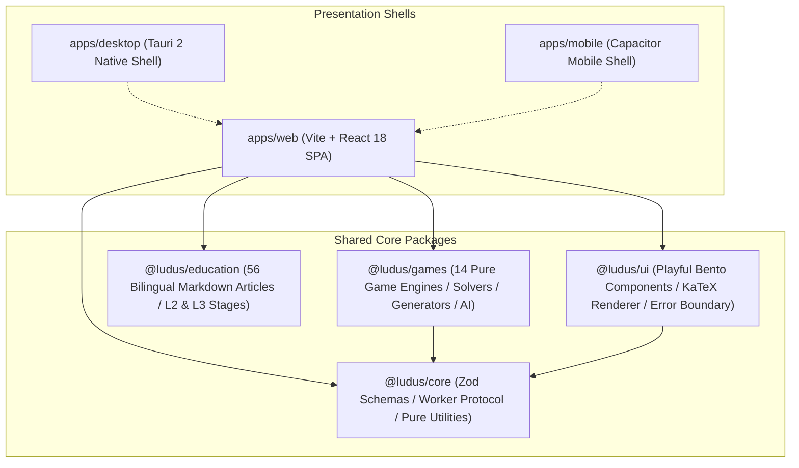

<div align="center">

# 🕹️ LUDUS

**Turning Deep Computer Science Algorithms & Discrete Mathematics into Addictive Games**

[](https://github.com/zxj0302/Ludus/actions/workflows/ci.yml)
[](https://zxj0302.github.io/Ludus/)
[](https://github.com/zxj0302/Ludus/actions)
[](https://github.com/zxj0302/Ludus/releases)
[](LICENSE)

[](https://www.typescriptlang.org/)
[](https://react.dev/)
[](https://tauri.app/)
[](https://pnpm.io/)
[](https://tailwindcss.com/)

[ 🇨🇳 简体中文 ](README.md) &nbsp; | &nbsp; [ 🇺🇸 English ](README.en.md)

<br/>

### 🚀 [Play Live Online Now ➔](https://zxj0302.github.io/Ludus/)

<br/>

</div>

---

## 📖 Introduction

**Ludus** (from the Latin for *"play"* or *"game"*) is an open-source educational game engine that bridges **discrete mathematics, combinatorial game theory, linear algebra, graph theory, and advanced search algorithms** with beloved puzzle classics.

We strictly follow a **"Play First, Inquire Naturally"** philosophy:
- **Zero Barrier for Casual Gamers**: Clean, playful bento aesthetic, tactile animations, and zero compulsory reading.
- **Progressive Heuristic Education**: Educational breakdowns are collapsed by default. When players wonder *"Why is this move optimal?"* or *"How does the AI compute this?"*, unfolding reveals step-by-step mathematical proofs, complexity analysis, and real-time algorithm state-space trees.

---

## 🌟 Key Highlights

| Highlight | Description |
| :--- | :--- |
| 🎮 **14 Algorithmic Games** | Covering combinatorial game theory, state-space planning, exact cover, and graph search. |
| 🧠 **5-Stage Pedagogical System** | Each game implements a structured **Play ➔ Think ➔ Reveal ➔ Solve ➔ Create** workflow (Bilingual en/zh-CN, L2 & L3 depth tiers). |
| ⚡ **Dedicated Web Worker Solvers** | Heavy A*, Alpha-Beta minimax, BFS, and DLX algorithms run on background threads to ensure 60 FPS UI responsiveness. |
| 📊 **Interactive Algorithm Visualizations** | Powered by React Flow, SVG, and Canvas to dynamically present GF(2) Gaussian elimination, minimax game trees, MEX DAGs, and BFS escape paths. |
| 📱 **Cross-Platform Architecture** | Single clean TypeScript core, seamlessly supporting Web SPA, GitHub Pages, Tauri 2 native desktop, and Capacitor mobile. |
| 🛡️ **Production Grade Quality** | 81 test files, **681 automated unit and integration tests** with 100% pass rate and strict zero-error TypeScript typing. |

---

## 🎮 Game Matrix & Algorithmic Showcase

| Icon | Game | Core Algorithm & Theoretical Foundation | Computational Complexity | Interactive Visualization |
| :---: | :---|:---|:---:|:---:|
| 💡 | **Lights Out** | GF(2) Galois field linear systems via Gaussian Elimination | $\mathcal{P}$ | Matrix reduction animation / Rank & Nullity |
| 📦 | **Sokoban** | State-space BFS with Topological Deadlock Pruning | $\text{PSPACE-complete}$ | BFS exploration tree / Shortest path |
| 🔢 | **Sudoku** | Knuth's Algorithm X with Dancing Links (DLX) | $\text{NP-complete}$ | Exact cover matrix / Candidate elimination |
| 🪙 | **Nim** | Bouton's Theorem / Nim-sum XOR ($\oplus$) $\mathcal{P}/\mathcal{N}$ analysis | $\mathcal{P}$ | Interactive game tree / Winning move indicator |
| 📐 | **Wythoff's Game** | Beatty sequences & Golden Ratio $\phi = \frac{1+\sqrt{5}}{2}$ spectrum | $\mathcal{P}$ | Cold positions phase space scatter plot |
| 🧩 | **15-Puzzle** | $\text{A}^*$ Heuristic Search with Manhattan Distance | $\text{NP-hard}$ | $\text{A}^*$ search frontier & expanded node tree |
| 🧪 | **Water Jug Puzzle** | Extended Euclidean Algorithm + Bézout's Identity + BFS | $\mathcal{P}$ | State transition phase graph / Optimal pour path |
| 🎨 | **Nonogram** | Constraint Satisfaction Problem (CSP) + Backtracking | $\text{NP-complete}$ | Line-by-line deduction / Multiple-solution detection |
| ⚪ | **Peg Solitaire** | Symmetry-Reduction DFS + Curated Classic Catalog | — | 31-step optimal solution playback |
| 🔴 | **Connect Four** | Alpha-Beta Pruning Minimax with Solved Openings | $\text{PSPACE}$ | Dynamic search depth & evaluation metrics |
| ➗ | **Euclid's Game** | Division Step Sizing + Golden Ratio $\phi$ Critical Threshold | $\mathcal{P}$ | Recursive Euclidean division steps |
| 🌲 | **Grundy's Game** | Sprague–Grundy Theorem + Minimum Excludant ($\text{mex}$) | $\mathcal{P}$ | $\mathcal{G}$-value state decomposition graph |
| 🎳 | **Kayles** | Octal Game Classification + A002186 Periodic Sequences | $\mathcal{P}$ | Partition tree / Winning strategy hints |
| 🏃 | **Thief Siege** | Escape Path BFS + Minimax Adversary Search | $\mathcal{P}$ | Escape route graph / Bottleneck encirclement |

---

## 🏛️ System Architecture

Ludus is built on a modular, decoupled **Monorepo** structure:



---

## 🛠️ Tech Stack

```
┌─────────────────────────────────────────────────────────────┐
│ Core:         TypeScript 5.5 + Zod 3 (Strict runtime contracts)│
│ Frontend:     React 18 + Tailwind CSS + Framer Motion       │
│ Visualizer:   React Flow + D3.js + KaTeX                    │
│ State:        Zustand 4 (Lightweight reactive store)         │
│ Workers:      Dedicated Web Workers (Off-thread computation)│
│ Native Shell: Tauri 2 (Rust / WebView2) + Capacitor 6       │
│ Tooling:      pnpm 9 + Vite 5 + Vitest 2 (Fast test runner)  │
└─────────────────────────────────────────────────────────────┘
```

---

## ⚡ Quick Start

### 1. Prerequisites
- **Node.js** $\ge 20.0.0$
- **pnpm** $\ge 9.0.0$
- *(Optional for desktop bundle)* **Rust** $\ge 1.85$

### 2. Installation & Development
```bash
# Clone the repository
git clone https://github.com/zxj0302/Ludus.git
cd Ludus

# Install dependencies
pnpm install

# Start web dev server (default: http://127.0.0.1:5173)
pnpm dev

# Start Tauri desktop shell
pnpm dev:desktop
```

### 3. Verification & Build
```bash
# Run all 681 automated unit and integration tests
pnpm test:run

# Global TypeScript type checking (0 errors)
pnpm typecheck

# Production Web SPA build
pnpm build

# GitHub Pages optimized build
pnpm build:pages

# Validate shell integration contracts
pnpm validate:shell

# Package Windows desktop installer (.msi / .exe)
pnpm build:desktop
```

---

## 📄 License

This project is licensed under the [MIT License](LICENSE).

<div align="center">
  <sub>Built with ❤️ by passionate computer science & mathematics educators.</sub>
</div>
