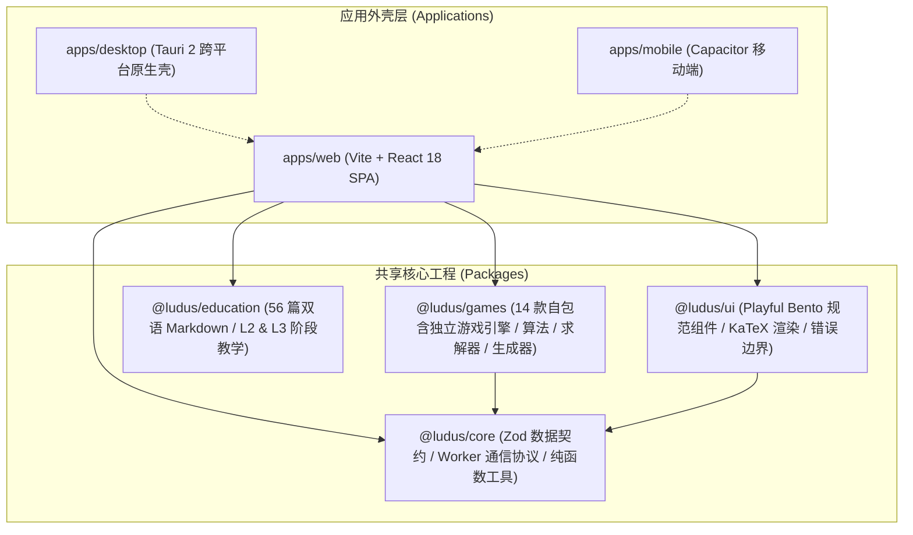

<div align="center">

# 🕹️ LUDUS

**寓教于乐的大型算法与数学游戏引擎**  
*Turning Deep Algorithms & Discrete Mathematics into Playful, Addictive Games.*

[](https://github.com/zxj0302/Ludus/actions/workflows/ci.yml)
[](https://zxj0302.github.io/Ludus/)
[](https://github.com/zxj0302/Ludus/actions)
[](https://github.com/zxj0302/Ludus/releases)
[](LICENSE)

[](https://www.typescriptlang.org/)
[](https://react.dev/)
[](https://tauri.app/)
[](https://pnpm.io/)
[](https://tailwindcss.com/)

[ 🇨🇳 简体中文 ](README.md) &nbsp; | &nbsp; [ 🇺🇸 English ](README.en.md)

<br/>

### 🚀 [立即在线体验 / Play Live Now ➔](https://zxj0302.github.io/Ludus/)

<br/>

</div>

---

## 📖 项目简介 (Introduction)

**Ludus**（源自拉丁语「游戏 / 玩乐」）是一个将**离散数学、图论、线性代数、博弈论与前沿算法**深度包裹在经典益智游戏中的开源工程。

我们坚持 **「游玩优先，自愿探究」** 的非侵入式理念：
- **纯粹娱乐零门槛**：作为普通益智游戏，界面清爽优雅、动效细腻、交互跟手；
- **渐进式启发式教育**：教育内容默认折叠收起。当玩家好奇「为什么这一步必胜？」或「AI 是如何思考的？」时，展开即可看到完整的数学证明、复杂度剖析与动态算法搜索树。

---

## 🌟 核心特色 (Key Highlights)

| 特色 | 说明 |
| :--- | :--- |
| 🎮 **14 款算法硬核小游戏** | 涵盖经典规划、组合博弈、精确覆盖、图上搜索等多种经典计算理论模型。 |
| 🧠 **五段式启发教学体系** | 每款游戏配备 **试玩 (Play) ➔ 思考 (Think) ➔ 揭秘 (Reveal) ➔ 求解 (Solve) ➔ 创造 (Create)** 渐进式教学（中英双语 L2/L3 深度）。 |
| ⚡ **多线程 Web Worker 求解器** | 复杂 A*、Alpha-Beta 剪枝、BFS 与 DLX 均在独立后台 Worker 运算，保持 60 FPS 丝滑 UI。 |
| 📊 **交互式算法全景可视化** | 借助 React Flow、SVG 及 Canvas 动态展现 GF(2) 矩阵消元、博弈搜索树、MEX 状态转移图及逃跑最短路。 |
| 📱 **全平台跨端架构** | 一套 TypeScript 核心，同时支持 Web SPA、GitHub Pages、Tauri 2 桌面客户端及 Capacitor 移动端。 |
| 🛡️ **严格的质量与稳定性** | 81 个测试套件，**681 项全量自动化测试** 100% 通过，端到端类型安全（0 Type Errors）。 |

---

## 🎮 游戏库与数学模型 (Game Matrix)

| 图标 | 游戏名称 | 核心算法与数学理论 | 计算复杂度 | 交互特性 |
| :---: | :---|:---|:---:|:---:|
| 💡 | **点灯游戏 (Lights Out)** | $\text{GF}(2)$ 伽罗瓦域有限域线性方程组高斯消元法 | $\mathcal{P}$ | 矩阵消元动画 / 秩与零度解析 |
| 📦 | **推箱子 (Sokoban)** | 状态空间 BFS + 拓扑不可达死锁剪枝 (Deadlock Pruning) | $\text{PSPACE-complete}$ | 搜索拓扑树 / 自动寻路 |
| 🔢 | **数独 (Sudoku)** | Knuth Algorithm X + Dancing Links (DLX) 双向十字链表 | $\text{NP-complete}$ | 矩阵覆盖轨迹 / 候选数推演 |
| 🪙 | **尼姆博弈 (Nim)** | Bouton 定理 / 异或和 (Nim-sum $\oplus$) $\mathcal{P}/\mathcal{N}$ 态分析 | $\mathcal{P}$ | 动态博弈树 / 必胜步自动高亮 |
| 📐 | **威索夫博弈 (Wythoff)** | Beatty 序列与黄金分割比 $\phi = \frac{1+\sqrt{5}}{2}$ 特征谱 | $\mathcal{P}$ | 奇异局势相空间轨迹点阵 |
| 🧩 | **十五数码 (15-Puzzle)** | $\text{A}^*$ 启发式搜索 + 曼哈顿距离约束 (Manhattan Distance) | $\text{NP-hard}$ | $\text{A}^*$ 搜索开闭集展开树 |
| 🧪 | **分水谜题 (Water Jug)** | 欧几里得辗转相除法 + 裴蜀定理 (Bézout's identity) + BFS | $\mathcal{P}$ | 状态转移相图 / 最短步数倒水 |
| 🎨 | **数织图 (Nonogram)** | 约束满足问题 (CSP) 线求解 + 深搜回溯 (Backtracking) | $\text{NP-complete}$ | 逐行约束推导 / 多解冲突检测 |
| ⚪ | **孔明棋 (Peg Solitaire)** | 对称约简深搜 (Symmetry Reduction DFS) + 经典棋局库 | — | 31 步经典解谱追踪回放 |
| 🔴 | **四子棋 (Connect Four)** | Alpha-Beta 剪枝极小化极大 (Minimax) 搜索 / 强解文献验证 | $\text{PSPACE}$ | 多档 AI 算力深度调节 |
| ➗ | **欧几里得博弈 (Euclid)** | 辗转相减除数倍率选择 + 黄金比 $\phi$ 临界步态分析 | $\mathcal{P}$ | 递归除法展开图 / 胜负态提示 |
| 🌲 | **格兰迪博弈 (Grundy)** | Sprague–Grundy 定理 + 最小除外数 $\text{mex}$ (Minimum Excludant) | $\mathcal{P}$ | $\mathcal{G}$ 函数转移图 / 状态分解 |
| 🎳 | **凯尔斯博弈 (Kayles)** | 八进制博弈分类 (Octal Game) + A002186 周期性特征分析 | $\mathcal{P}$ | 状态划分分支树 / 胜态判定 |
| 🏃 | **十面围城 (Thief Siege)** | 逃逸最短路 BFS + 动态极小化对抗搜索 (Adversary Search) | $\mathcal{P}$ | 逃生路径图 / 瓶颈包围分析 |

---

## 🏛️ 架构设计 (System Architecture)

Ludus 采用高度解耦的 **Monorepo** 分层架构：



- **逻辑与视图彻底解耦**：所有游戏规则、求解器、AI 及生成器均位于 `@ludus/games`，为纯 TypeScript 模块，不依赖任何 DOM 或 React API。
- **即插即用插件系统**：增加新游戏只需实现统一的 `GamePlugin` 接口，一键注册即可接入 Hub、全局状态、多语言及可视化插槽。
- **无闪烁状态容灾**：完备的取消机制与时序校验（`activeSolveCancel`），杜绝快速切关或切游戏导致的 Worker 状态竞态污染。

---

## 🛠️ 技术栈 (Tech Stack)

```
┌─────────────────────────────────────────────────────────────┐
│ Core:         TypeScript 5.5 + Zod 3 (严格类型与运行时校验)     │
│ Frontend:     React 18 + Tailwind CSS + Framer Motion       │
│ Visualization:React Flow + D3.js + KaTeX                    │
│ State:        Zustand 4 (轻量响应式状态机)                   │
│ Solver Run:   Dedicated Web Workers (离线无阻塞计算)          │
│ Desktop/App:  Tauri 2 (Rust / WebView2) + Capacitor 6       │
│ Toolchain:    pnpm 9 + Vite 5 + Vitest 2 (极速单测与构建)     │
└─────────────────────────────────────────────────────────────┘
```

---

## ⚡ 快速开始 (Quick Start)

### 1. 环境准备
- **Node.js** $\ge 20.0.0$
- **pnpm** $\ge 9.0.0$
- （若编译桌面端）**Rust** $\ge 1.85$

### 2. 安装与运行
```bash
# 克隆仓库
git clone https://github.com/zxj0302/Ludus.git
cd Ludus

# 安装所有依赖
pnpm install

# 启动 Web 开发服务器 (默认: http://127.0.0.1:5173)
pnpm dev

# 启动 Tauri 桌面端开发环境
pnpm dev:desktop
```

### 3. 测试与打包
```bash
# 执行全部 681 项自动化单元测试与集成测试
pnpm test:run

# 全局 TypeScript 严格类型检查 (0 错误)
pnpm typecheck

# 构建生产版 Web SPA
pnpm build

# 构建 GitHub Pages 适配版本
pnpm build:pages

# 验证桌面与移动套壳一致性契约
pnpm validate:shell

# 构建 Windows 桌面端安装包 (.msi / .exe)
pnpm build:desktop
```

---

## 📊 质量与自动化 (CI / CD)

本项目在 GitHub Actions 配置了严格的持续集成（CI）与持续部署（CD）工作流：

- 🔄 **自动类型检查**：每次推送强制执行多项目 `pnpm typecheck`；
- 🧪 **全矩阵测试**：覆盖所有博弈算法的不变性测试、死锁证明、难度分布校验与边界用例；
- 📦 **零配置自动部署**：代码合并进 `master` 分支后自动构建并秒级部署至 [GitHub Pages](https://zxj0302.github.io/Ludus/)。

---

## 🤝 参与贡献 (Contributing)

热烈欢迎提交 Issue 与 Pull Request！
- 开发前请先阅读 [CONTRIBUTING.md](CONTRIBUTING.md)。
- 查看项目最新演进日志请参考 [CHANGELOG.md](CHANGELOG.md)。
- 新增游戏规范可查阅 `docs/specs/` 与 `packages/games/README.md`。

---

## 📄 开源许可证 (License)

本项目采用 [MIT License](LICENSE) 开源许可证。自由学习、修改与分享。

<div align="center">
  <sub>Built with ❤️ by passionate computer science & mathematics educators.</sub>
</div>
